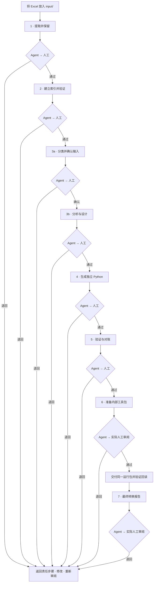

# excel_to_act

[English](README.md) | 简体中文

本项目采用 [MIT 许可证](LICENSE)。

面向 Agent 的完整转换入口是 [`excel-to-act` Skill](.agents/skills/excel-to-act/SKILL.md)。[发布指南](docs/release.md)说明带版本的 Skill/插件 ZIP、配套 Python wheel、安装、校验清单及发布条件。运行时包含第 6 步交付和第 7 步报告的专用 Skill。

Excel to Act 通过七个审阅步骤，把 Excel 模型转换为独立 Python 工具：提取、索引、输入确认与设计、代码生成、验证、内部交付和最终转换报告。提取定稿后，使用 `step1 report` 开始流程。每一步的确切 JSON/Markdown 报告对都须先经 Agent 审阅，再由用户明确决定。

## 流程



运行 `step1 report --run FINAL_RUN --out NEW_DIR`，再按第 2–5 步命令和审阅要求操作。第 5 步批准后，运行 `workflow bind-comparison --workflow NEW_DIR --comparison COMPARISON.json --comparison-sha256 APPROVED_SHA256` 绑定匹配的对比证据，哈希须来自独立核验记录。`workflow status --workflow DIR` 显示当前证据、有效的内部交付和下一步。第 6 步交付前须审阅确切工具包及报告对，交付后须成功执行并验证文件回读。[工作流指南](docs/workflow.md)同时说明如何只读挂接已批准的父流程证据。

## CLI 与交付物

运行 `excel-to-act stepN tools`、`excel-to-act stepN agent` 或 `--help`，查看当前命令、限制和说明。

| 步骤 | 主要命令 | 主要交付物 |
| --- | --- | --- |
| 1 · 提取 | `step1 convert`、`check`、`finalize`、`report` | 保留的源文件部件、清单、`import_checkpoint.json/.md` |
| 2 · 索引与读取 | `step2 index`、`validate`、`prepare`、`query`、`trace`、`report` | 索引、来源绑定的读取包、有界证据包与轨迹 |
| 3 · 分析与设计 | `step3 prepare`、`fields`、`dependencies`、`input-catalog`、`query`、`trace`、`source-trace`、`produce-exact-cases`、`profile`、`plan`、`check`、`report`、`interface` | 已确认输入、目标、源候选、变量、方程、模块及 `analysis_design.json/.md` |
| 4 · 生成 | `step4 capture-external`、`discover`、`plan`、`generate` | 模块化独立运行包、源映射、单独的输入/元数据记录、生成报告 |
| 5 · 验证 | `step5 validate`、`oracle`、`reconcile`、`finalize-cases` | 隔离执行证据、原生 Excel 捕获、数值对比报告 |
| 6 · 内部工具包 | `step6 candidate`、`deliver`、`revoke` | 版本化运行包、候选 JSON/Markdown 对、独立交付和回读记录 |
| 7 · 最终报告 | `step7 report`、`skill`、`template` | 面向人的转换报告和 JSON 证据 |
| 流程 | `workflow attach`、`bind-comparison`、`status`、`confirm`、`reject` | 流程来源、当前决定及有效的内部交付 |

Step 3 从声明的结果倒推，并确认标量、向量、表格、原始输入和公式派生输入边界。Step 4 仅在语义映射和实现预检通过后，为受支持且绑定清楚的设计生成模块化代码。请检查当前工具目录和来源适配器所支持的公式与输入形状；本流程不是通用 Excel 编译器。公式缓存不是模型输入，提取阶段不会运行 VBA。Step 4 冒烟证据只证明运行包可执行。原生 Excel 对比需要 Windows 和 Microsoft Excel。已测试场景不代表所有参数组合覆盖、精算认证、反馈求解或 GPU 支持。

主要交接报告先说明待审阅决定、用途和范围、已验证结果、限制、未决问题、JSON/Markdown 证据链接以及下一步审阅操作。详细来源信息与审阅记录留在证据附录中。缺失事实标为未知或“未记录”，不能写成零。`workflow.json` 是当前验收台账。

## 使用

需要 Python 3.11+。使用 VBA 检查工具时，请安装可选的 `vba` 扩展。

[第 1 步示例](examples/README.md)会自行创建测试工作簿，并完成提取、检查和定稿。设计的支持域为 `exact_cases` 时，请按[有限场景准备](docs/cli.md#finite-case-preparation)和 [32 场景验证](docs/cli.md#exact-case-validation)操作。每个请求都须单独验证并捕获对应的原生 Excel 结果；只有汇总全部 32 个已批准场景的 `finalize-cases` 才会创建正式第 5 步检查点。

```powershell
python -m pip install -e ".[vba]"
excel-to-act step1 tools
excel-to-act step1 agent
excel-to-act workflow status --workflow WORKFLOW_DIR
$BUNDLE = "output/WORKFLOW/stage4/bundles/revision-NNNN/bundle"
python "$BUNDLE/model.py" --inputs "REQUEST.json" --out "output/result.json"
```

## 开发与打包

从仓库根目录运行以下命令。每次构建前先清理生成的 `build/` 目录，确保 setuptools 打包当前源代码与资源。源代码和工作流证据应保存在 `build/` 之外。

```powershell
python -m pip install -e ".[dev]" build
python -m pytest -q
python -m ruff check .
if (Test-Path -LiteralPath .\build) { Remove-Item -LiteralPath .\build -Recurse -Force }
python -m build --outdir output/package-build
```

这些开发构建写入 `output/package-build/`。带版本的分发包请按[发布指南](docs/release.md)操作；该流程要求在全新目录中构建，并保留每份完整安装包。构建安装包不会批准或交付转换后的模型。

参见[七步工作流](docs/workflow.md)、[CLI 指南](docs/cli.md)、[通用 Agent 约定](docs/design/generic_agent_contracts.md)、[结果驱动分析指南](docs/design/result_driven_analysis.md)和[报告约定](docs/design/model_conversion_report.md)。`input/` 和 `output/` 下的源工作簿及运行证据属于本地数据。根目录 README 中英文版本为双语；其他作者编写的项目文档为英语。
